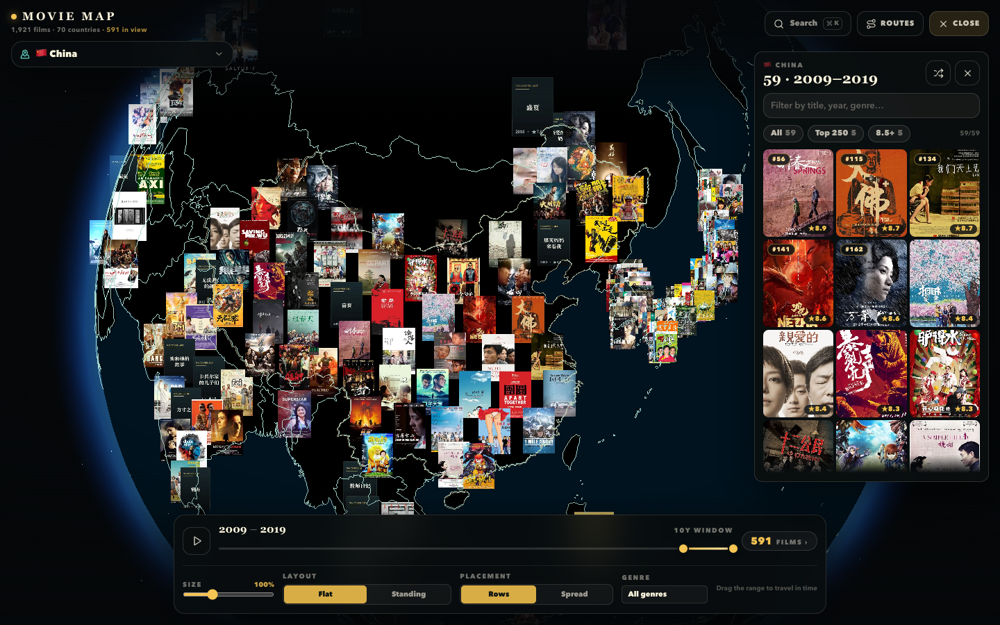

# 电影地图 · Movie Map

> 一百年的电影，钉在它诞生的国家上。

一颗可交互的地球，每张海报都是一部电影，落在这部电影的出品国上。拖动时间轴或点播放，看着电影史在球面上生长；点一个国家看它所有的片；点一张海报看故事。

**在线体验：<https://jacksonwuu.github.io/beauty-data/>**



## 功能

- **时间轴播放** — 拖两端滑杆选年份区间，或点 ▶ 让它一年一年地走；布局只在松手时重算，拖动时保持 50+ fps。
- **70 个国家 / 1,921 部电影** — 数据来自豆瓣全量 dump，贝叶斯加权排序 + 按国家配额，避免"美国地图"。
- **海报图集（texture atlas）** — 所有海报拼成 129 张 816×728 的分块图集（每张 15 格），首屏只拉 39 张、约 3.3 MB，而不是 1,900 个图片请求。
- **按需唤醒** — 地球背面那一半卡片不会提前加载纹理，等它转到镜头这一侧才取图。
- **主题路线** — 12 条策展路线：法国新浪潮、日本黄金时代、新好莱坞、意大利新现实主义、香港武侠与功夫、韩国新浪潮、黑色电影、动画百年、东欧与苏联、伊朗新电影、西部片、城市夜行。逐站播放，每站自动飞到该国并打开影片详情。
- **全局搜索 ⌘K** — 跨国家搜索，当前国家的结果优先，其余折叠在 "Elsewhere"。
- **深链分享** — `?country=JP&from=1950&to=1965`、`?route=korean-new-wave&stop=2`、`?movie=movie-1291546` 都能直接打开。
- **详情按需加载** — 剧情简介/演员/语言/标签拆成 16 个 shard，打开时才拉，首屏包小 25%。

## 性能

在 headless Chrome（1440×900、SwiftShader、关闭 vsync）下测量，基线为优化前的提交：

| 指标 | 优化前 | 优化后 |
| --- | --- | --- |
| 首屏图片请求 | 248 | 2（图集） |
| 首屏图片传输 | 6.52 MB | 3.35 MB（1,921 部片，按需唤醒） |
| JS 堆 | 50.6 MB | 29.1 MB |
| FPS（无 vsync） | 33 | 51 |
| DOMContentLoaded | 202 ms | 108 ms |
| 主包 gzip | 993 kB | 751 kB |

关键改动：

1. **海报图集**替代 1,900+ 个 ``/`Texture`；卡片共用纹理、UV 偏移到自己的格子，缩放时再按需换成单片高清海报。
2. **悬停只解析一次/帧**，不再每个 pointermove 做一次 24 万顶点的点在多边形内判断。
3. **国家高亮改用三角化几何面片**，代替每次悬停重建 4096×2048 画布（≈32 MB 上传）。
4. **年份滑杆 split commit** — 拖动只改 UI，松手才重排地球。
5. **按国家缓存布局**，同一批电影反复切参数时直接复用排布。
6. **手动分包** — react / three+globe / world-atlas 三个 vendor chunk，主包与第三方分离缓存。

## 本地开发

```bash
pnpm install
pnpm --filter movie-map dev        # http://localhost:5173
```

### 重新生成数据（可选）

需要仓库外的原始数据与海报（**不在公开仓库里**，见下方"版权"）：

```bash
# data/movies.csv 为豆瓣 dump
pnpm --filter movie-map generate:movies    # 写 src/data/movies.ts 与详情分片
pnpm --filter movie-map posters:download   # 下载海报原图到 data/poster-sources/
pnpm --filter movie-map posters:web        # 裁成 480×720 webp + 拼分块图集
```

没有这些文件也能开发：`posterUrl` 为空时 UI 自动退化成排版卡片。

## 公开构建

```bash
pnpm build:public     # 输出 apps/movie-map/dist-public
```

`VITE_PUBLIC_DATA=1` 时会走"公开模式"：裁切后的海报与图集（`public/posters/`）会一起打包，产物约 90 MB；`public/` 下没被白名单放行的目录在构建后会被删掉。想做一个不带海报的版本，把 `public/posters/` 移走再构建即可，UI 会自动退化成排版卡片。

## 部署

线上版本跑在 **GitHub Pages**：`gh-pages` 分支存放 `dist-public`，域名 <https://jacksonwuu.github.io/beauty-data/>。

```bash
pnpm build:public                                        # 或加上 --base /beauty-data/
cd apps/movie-map/dist-public && git add -A && git commit -m deploy && git push origin gh-pages
```

仓库根目录也带了 `vercel.json`（构建 `pnpm --filter movie-map build:public`，输出 `apps/movie-map/dist-public`），在 Vercel 里 Import 这个仓库即可一键部署到自有域名。任何静态托管同理。

### 更新线上

```bash
pnpm build:public && rsync -a --delete apps/movie-map/dist-public/ ../deploy/  # 或直接把 dist-public 推到 gh-pages
```

## 数据与版权

- 电影元数据（片名、年份、国家、评分、票数、导演、演员、语言、标签、简介）抓取自豆瓣，**版权归豆瓣及各权利人所有**，仅用于个人学习与非商业展示。
- 海报图片是从豆瓣取回后裁切压缩的，**不在 git 仓库里**（可在本地重建）；线上演示站为了展示效果包含了这些图片，仅作个人学习与非商业展示。
- 若权利人认为有不妥，请开 issue，我会立刻移除相关内容。
- 世界地图轮廓数据来自 [world-atlas](https://github.com/topojson/world-atlas)（ISC），渲染用 [three.js](https://threejs.org/)（MIT）、[React Three Fiber](https://github.com/pmndrs/react-three-fiber)（MIT）。
- 港澳台在数据中归入 `CN`，香港的在地表达通过 `originalRegions` 在路线里保留。

## 结构

```
apps/movie-map        电影地图应用（React 19 + Vite 6 + R3F）
  scripts/            数据生成、海报下载、图集打包
  src/components/     TopBar / ControlBar / MoviePanel / RoutePanel / GlobalSearch …
  src/data/           movies.ts（生成物）、routes.ts（12 条路线）
packages/globe-core   可复用的 R3F 地球组件
```

## License

代码 MIT。数据与海报见上方"数据与版权"。
